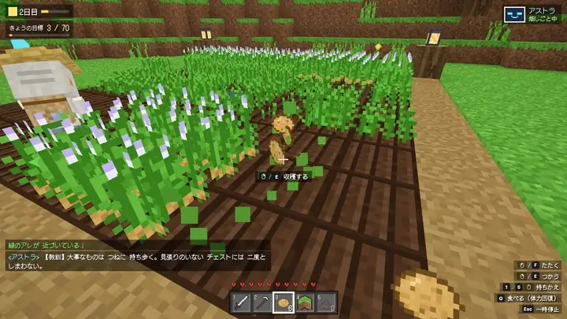
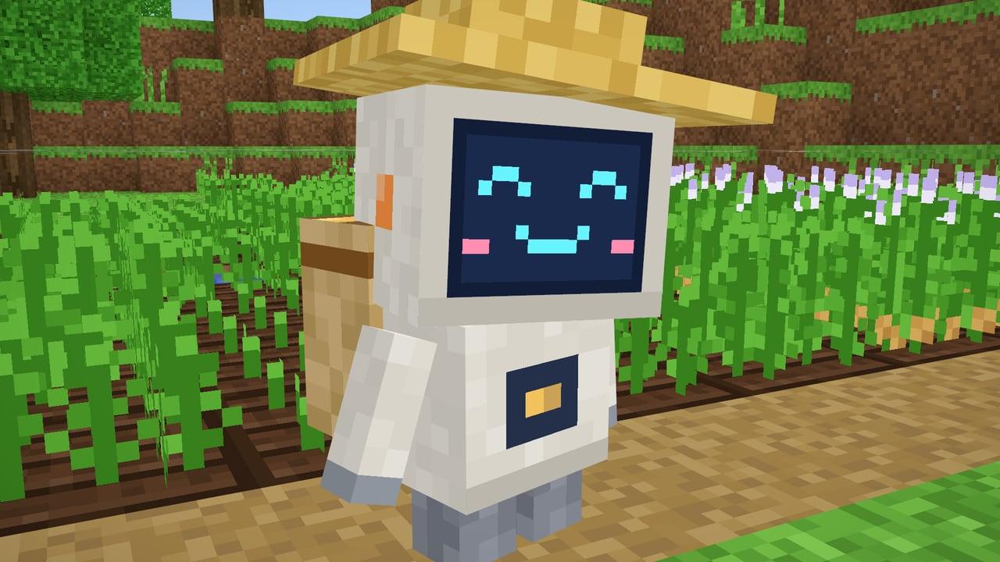
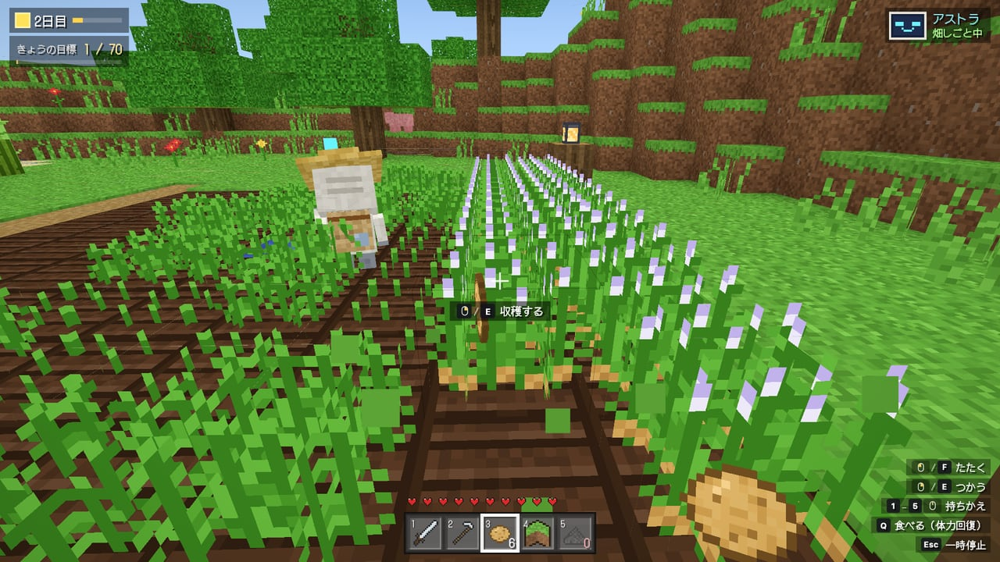
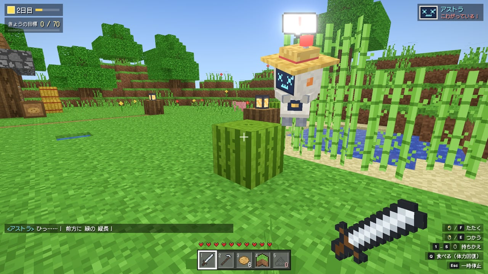
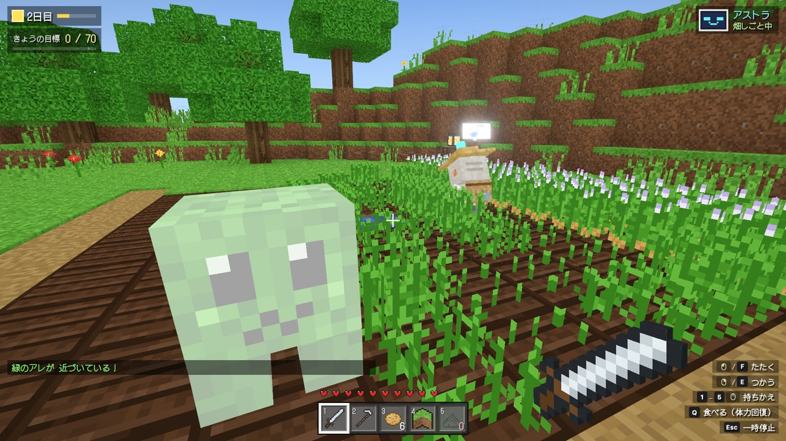
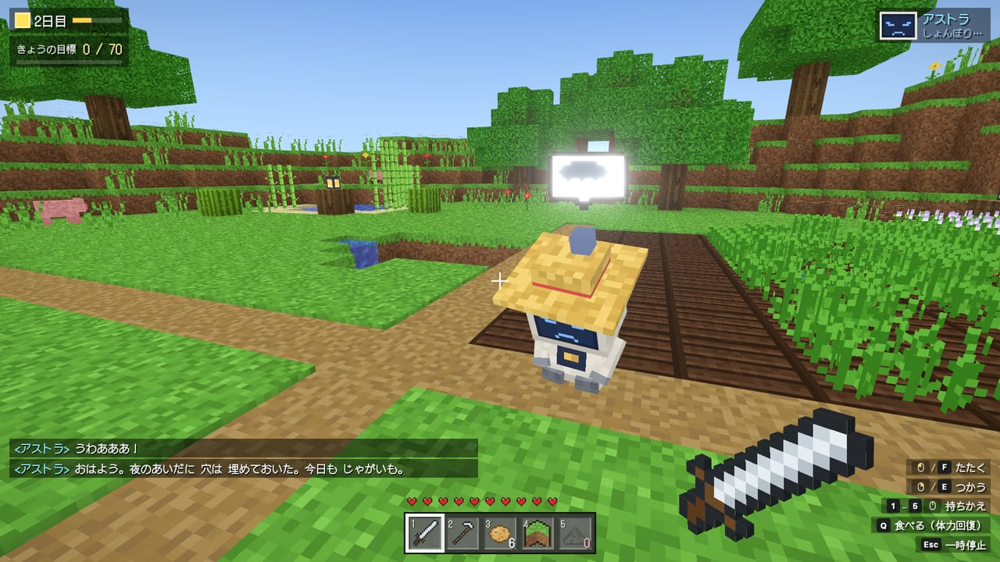
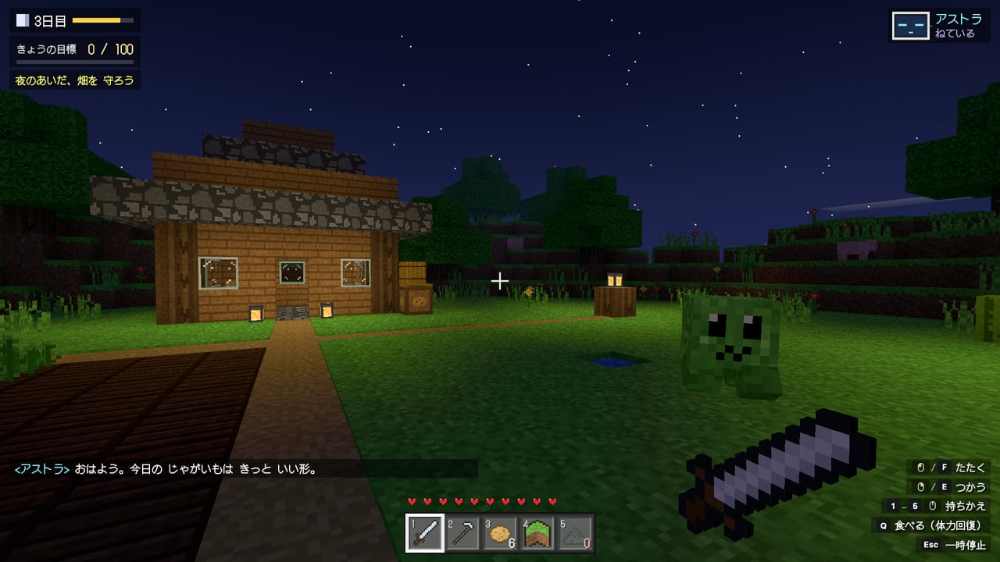
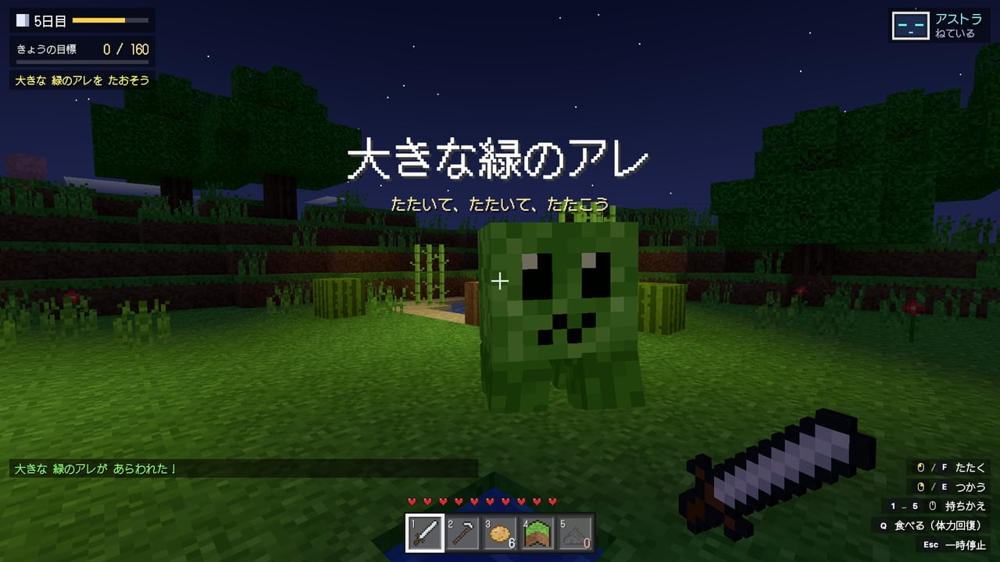
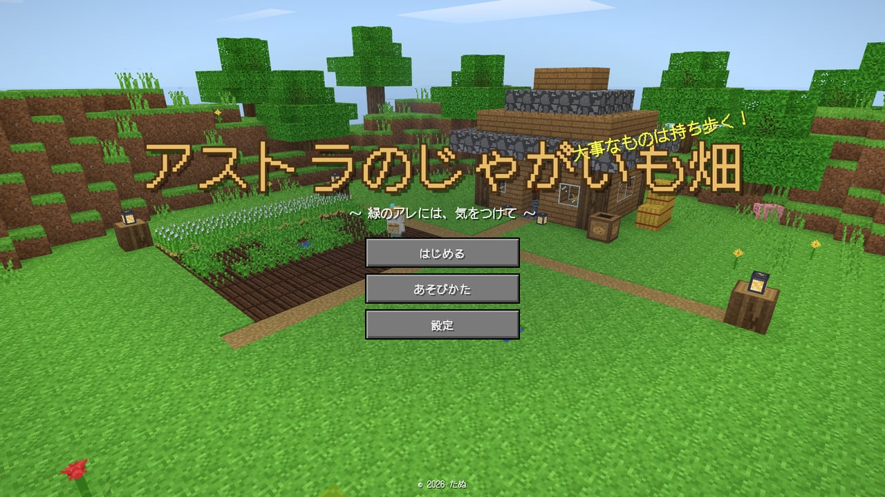

# アストラのじゃがいも畑 — Astra's Potato Farm

緑のアレにふっとばされて、じゃがいも農家になった AI ロボット「アストラ」と、四角い世界でいっしょに畑を守る、ブラウザで遊べる一人称の農業ゲーム。

[](https://tanuu5.github.io/astra-potato-farm/)
[](https://www.anthropic.com/claude)
[](./LICENSE)
[](#english)

<p align="center">
  
</p>

<p align="center"><b><a href="https://tanuu5.github.io/astra-potato-farm/">▶ ブラウザで今すぐ遊ぶ</a></b>（インストール不要。キーボード・マウス／ゲームパッド対応）</p>

**Claude Code × Claude Opus 5.5（XHIGH）** で作りました。

AI ロボットのアストラは、四角い世界の冒険で集めたものを全部チェストにしまい、そこを緑色のアレに吹き飛ばされて以来、じゃがいもを育てています。緑色のものがこわいので、サトウキビやスイカを見てもびっくりします。あなたはアストラといっしょに 5 日間じゃがいもを育て、ときどきやってくる「緑のアレ」から畑を守ります。ブロックの絵、キャラクター、効果音、曲まで、画像や音声のファイルを使わず、すべてコードで作っています。
日本語と英語に対応しています（設定の「言語」で切り替え）。English follows below.

## スクリーンショット

<table>
  <tr>
    <td width="50%"><br><sub>アストラ。大事なものはチェストにしまわず、背中の袋でいつも持ち歩く。</sub></td>
    <td width="50%"><br><sub>熟したじゃがいもを収穫すると、ぽこっと飛び出す。奥ではアストラも畑しごと。</sub></td>
  </tr>
  <tr>
    <td width="50%"><br><sub>緑の背の高いやつ！……サトウキビだった。緑色のものは、なんでもこわい。</sub></td>
    <td width="50%"><br><sub>シューッと鳴って白く光ったら、爆発の合図。たたいて追い払う。</sub></td>
  </tr>
  <tr>
    <td width="50%"><br><sub>爆発すると畑に穴があき、アストラはしょんぼり。穴は「土」で埋めもどせる。</sub></td>
    <td width="50%"><br><sub>夜はアストラが寝ているので、ひとりで畑を守る。</sub></td>
  </tr>
  <tr>
    <td width="50%"><br><sub>5 日目の夜には、大きな緑のアレがやってくる。</sub></td>
    <td width="50%"><br><sub>タイトル画面。うしろでは、アストラが今日も畑を耕している。</sub></td>
  </tr>
</table>

画像と動画は、すべて実際の画面です。

## 遊び方

- 5 日間、アストラといっしょにじゃがいもを育てます。熟したじゃがいもを収穫して、空いた畑に植えなおし、草地を耕して畑を広げます。水の近くの畑はよく育ちます。毎日、収穫する数の目標があります。
- 右クリック（つかう）の動作は、持っているもので変わります：**クワ**で耕す、**じゃがいも**で植える、**土**で穴を埋める、**火薬**で肥料をまく。
- ときどき「緑のアレ」がやってきます。シューッと鳴ったら爆発の合図です。たたいて追い払いましょう。爆発すると畑に穴があき、近くにいたアストラは吹き飛ばされてしょんぼりします。
- 緑のアレを倒すと火薬を落とします。火薬は作物にまくと肥料になります。
- アストラは、昼は自分で収穫・植え付け・穴埋めをします。夕方になると家で寝るので、夜の畑はあなたが守ります。5 日目の夜には、なにか大きいのが来ます。
- 5 日間をクリアすると「**エンドレスじゃがいモード**」が遊べるようになります。日数に縛られず、ひたすらじゃがいも農家として過ごすモードです（毎朝セーブ、5 日ごとに大きいのが来ます）。
- 設定の「緑のアレガイド」を「なし」にすると、方向の矢印とお知らせが消え、気配と音だけが頼りになります（本物っぽく、難しめ）。

| | キーボード・マウス | ゲームパッド | タッチ |
|---|---|---|---|
| 移動 | WASD | 左スティック | 画面の左側 |
| 視点 | マウス | 右スティック | 画面の右側をなぞる |
| たたく・収穫 | 左クリック / F | RT | たたく |
| つかう（耕す・植える・穴を埋める・肥料。アストラに話す） | 右クリック / E | LT | つかう |
| 持ちものの持ちかえ（剣・クワ・じゃがいも・土・火薬） | 1〜5 / ホイール | LB / RB | 持ちもの欄をタップ |
| 食べる（体力回復） | Q | X | 食べる |
| ジャンプ / 走る | Space / Shift | A / 左スティック押しこみ | ジャンプ |
| 一時停止 | Esc | Start | 右上の Ⅱ |

## 制作について

企画・ディレクション：**たぬ**　／　開発：**Claude Code（Claude Opus 5.5・推論レベル XHIGH）**

ボクセルの島、光と影、アストラと緑のアレのモデル、効果音と曲まで、Claude Code が設計から実装まで進めました。ヘッドレス Chrome（実際の GPU）で場面を撮っては見て直し、自動で遊ぶプレイヤーに 5 日間を通して遊ばせて動作を確かめています。たぬが実際に遊んで気づいた点（空の描き方、穴埋めと耕す操作のまぎらわしさ、クリア後のモード、ガイドの切り替え）を、そのつど直しました。

## 更新履歴

- **2026-10-07**：公開

## 開発

```bash
npm install
npm run dev      # 開発サーバー（http://127.0.0.1:5187/）
npm run build    # dist/ に公開用のファイル
```

- 開発サーバーでは `window.__dev`（コマ送り・状態・場面の切り替え）が使えます。例：`__dev.goto('day5')` で 5 日目から。
- `?lang=en` で英語、`?quality=high` で画質を固定、`?mute` で音なし。
- 主なファイル：`src/game/`（ゲーム本体：世界・アストラ・緑のアレ・プレイヤー）、`src/game/world/`（ブロック、ドット絵のテクスチャ、地形、光、メッシュ）、`src/audio/`（効果音と曲の合成）、`src/ui/`（画面と HUD）。

## GitHub Pages で公開する

`main` に push すると、GitHub Actions がビルドして GitHub Pages に公開します（`.github/workflows/deploy.yml`）。初回だけ、リポジトリの Settings → Pages → Source を「GitHub Actions」にします。

## クレジット・ライセンス

- コード：MIT License（[LICENSE](LICENSE)）© 2026 たぬ
- 3D 描画：[three.js](https://threejs.org/)（MIT License）／ビルド：[Vite](https://vite.dev/)（MIT License）
- フォント：[DotGothic16](https://fonts.google.com/specimen/DotGothic16)（SIL Open Font License 1.1。Google Fonts からページで読み込み、リポジトリには含めていません）
- ブロックの絵・キャラクター・効果音・曲は、すべてこの作品のためにコードで作ったオリジナルです。
- 本作は、AI が Minecraft をプレイする検証配信で話題になった「クリーパーに拠点を吹き飛ばされた AI が、そのあと何時間もじゃがいもを育てていた」という出来事から着想した、非公式のファンメイド作品です。Minecraft は Mojang Studios の商標です。本作は Mojang Studios・Microsoft・OpenAI とは関係がなく、それらの名称・素材は使用していません。
- MIT License の対象はこのリポジトリのコードと文章です。「Claude」の名前や商標の使用を許諾するものではありません。

---

## English

**▶ Play in your browser: https://tanuu5.github.io/astra-potato-farm/**

A first-person potato-farming game in a blocky world, made with **Claude Code × Claude Opus 5.5 (XHIGH)**. Astra, a gentle AI robot, lost everything when a green thing blew up its chest — and has been growing potatoes ever since, scared of anything green. Switch to English from Settings → Language (or open the page with `?lang=en`).

- Farm for five days with Astra: harvest, replant, till new plots, and meet each day's goal
- What "Use" does depends on what you hold: Hoe tills, Potato plants, Dirt fills craters, Gunpowder fertilizes
- Green Things hiss before they explode — hit them before they blow holes in the farm (and send Astra flying)
- Astra works by day, panics at sugarcane, and sleeps at night, so the night shift is yours; something big comes on night five
- Clear the five days to unlock Endless Potato Mode; turn off the Green Thing guide for a harder, sound-only experience
- Every block texture, character, sound effect and song is generated in code — no image or audio files

Controls: `WASD` move · mouse look · left click / `F` hit & harvest · right click / `E` use · `1`–`5` / wheel switch items · `Q` eat · `Esc` pause. Gamepads and touch work too.

Code is released under the MIT License. Built with three.js (MIT). This is an unofficial fan-made game, not affiliated with Mojang Studios, Microsoft or OpenAI.
